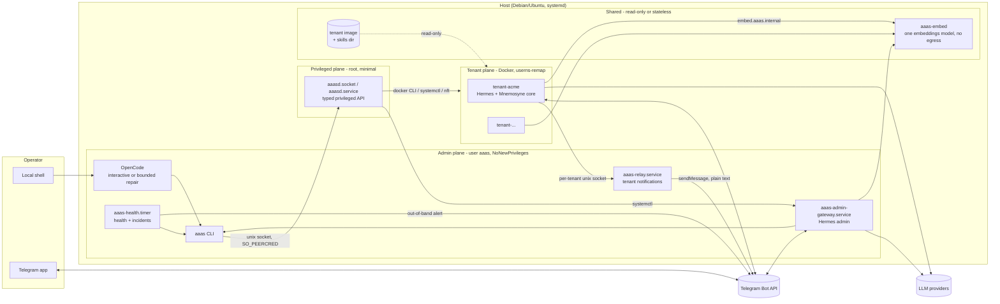
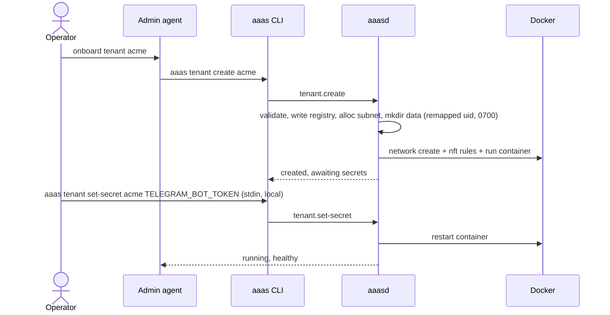
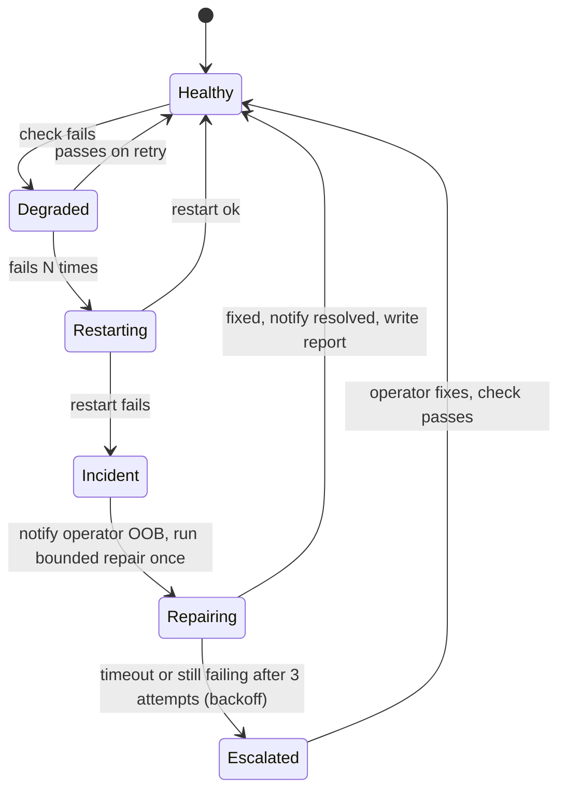

# AaaS Target Architecture (v0.2)

Status: **Proposed**, awaiting operator approval.
Scope: single Linux host, at most 50 tenants, one Telegram bot per tenant, Debian/Ubuntu, bash bootstrap plus stdlib Python.
Decisions are recorded as ADRs in [`docs/adr/`](adr/).

---

## 1. Goals and non-goals

**Goals, in priority order**

1. **Tenant isolation.** One tenant cannot reach another tenant's data, network, or process space. Platform tooling, including both admin LLM agents, has no path to tenant data.
2. **Least privilege.** No agent or service holds more authority than its job requires. The admin agents never hold root.
3. **Reliability.** The host converges to its declared state on its own. Failures are detected, contained, retried with backoff, and escalated to a human through a channel that does not depend on the failing component.
4. **Reproducibility.** A given release installs the same bits every time. Upgrades are atomic and can be rolled back.
5. **Efficiency.** Fifty tenants fit on one modest host with bounded resources per tenant, and nothing runs that doesn't need to. **Chat LLMs are always API-based.** The host needs no GPU.
6. **Share everything that holds no tenant state.** One tenant image, one skills directory, one embeddings service, one relay, and one set of platform services serve all tenants. Each tenant gets its own copy only of what holds its state: its Hermes process, memory, secrets, and Telegram bot (ADR-0010).
7. **Tenant-owned billing.** Each tenant brings their own provider API keys. There is no shared operator key, no pooled budget, and no metering by the platform.

**Non-goals**

- Multi-host scheduling. A seam for it is kept (ADR-0001).
- Protecting tenants from a malicious operator who has root. Root can always read the disk. We guarantee that *platform tooling* never exposes tenant data. Stronger guarantees would need confidential computing and are out of scope.
- Web or HTTP ingress for tenants. There are no inbound ports.

---

## 2. Threat model (summary)

| Actor | Trust | Primary risks | Primary controls |
|---|---|---|---|
| Operator (Telegram allowlist / local shell) | Trusted | Mistakes, phished Telegram account | Out-of-band confirmation codes for destructive actions (ADR-0009); audit log |
| Admin LLM agents (Hermes admin, OpenCode) | **Semi-trusted.** They follow instructions but can be manipulated or wrong | Prompt injection, over-broad actions, runaway repair loops | No root; privileged ops only through a narrow typed API (ADR-0002); never see tenant-controlled text (ADR-0004); bounded unattended repair (ADR-0005) |
| Tenant user and tenant agent | **Untrusted** | Container escape, lateral movement, data exfiltration from others, notification spam or injection | userns-remap, hardened container profile, per-tenant network plus egress firewall (ADR-0003); relay with schema and rate limit (ADR-0004); shared services are stateless with no egress (ADR-0010) |
| Upstream supply chain (Hermes, opencode, npm, Docker) | Semi-trusted | Breaking or malicious releases | Pinned versions and checksums (ADR-0007); signed platform releases (phase 4) |

---

## 3. Component view



### 3.1 Privileged plane: `aaasd` (ADR-0002)

A small root daemon written in **stdlib-only Python**. It is started on demand by the socket `/run/aaas/aaasd.sock` (mode `0660`, group `aaas-admin`) and authenticates callers with `SO_PEERCRED`. It is the **only** component allowed to touch Docker, systemd units, nftables, or tenant secrets.

- There are no sudoers rules. `aaas` is **not** in the `docker` group.
- Every request is a typed verb with validated arguments, for example `tenant.create {id: "^[a-z][a-z0-9-]{2,30}$"}`. It never accepts a shell string.
- Every call is written to journald with the caller's uid, the verb, the arguments (secrets redacted), and the result. This is the audit trail.
- Destructive verbs (`tenant.destroy`, `tenant.restore`, `platform.uninstall`) use two-step confirmation. The code goes to the operator out-of-band, never back to the caller (ADR-0009).
- Its code lives in the root-owned release tree and is read-only to `aaas`.

Verbs in v0.2:

| Area | Verbs |
|---|---|
| Admin gateway | `gateway.status`, `gateway.restart` |
| Tenants | `tenant.create`, `tenant.list`, `tenant.status`, `tenant.start`, `tenant.stop`, `tenant.restart`, `tenant.set-secret`, `tenant.update-image`, `tenant.backup`, `tenant.destroy` (two-step), `tenant.restore` (two-step) |
| Platform | `platform.health`, `platform.reconcile`, `platform.upgrade`, `platform.rollback` |
| Shared services | `shared.status`, `shared.restart` |
| Confirmation | `confirm <code>` |

There is deliberately **no** verb that returns tenant logs, conversations, memory, or files. `tenant.status` returns runtime metadata only: state, uptime, restart count, resource usage, and image version.

### 3.2 Admin plane (user `aaas`)

| Unit | Role | Hardening |
|---|---|---|
| `aaas-admin-gateway.service` | Hermes admin, our own unit with a fixed name (ADR-0007) | `NoNewPrivileges`, `ProtectSystem=strict`, `ReadWritePaths=/var/lib/aaas/admin`, `PrivateTmp`, `ProtectKernel*`, `Restart=on-failure` with a start-limit burst |
| `aaas-health.timer` / `.service` | Health checks, incident state machine, bounded repair (ADR-0005) | Same, plus `RuntimeMaxSec` |
| `aaas-relay.service` | Tenant-to-operator notification relay (ADR-0004) | Same, plus `IPAddressAllow=` limited to Telegram |
| OpenCode (interactive) | The operator runs `aaas admin` locally, which starts opencode as `aaas` in the admin workspace | Permission profile in `opencode.json` |

Both admin agents operate the platform **only** through the `aaas` CLI, which is a thin client for `aaasd`. Skills document `aaas ...` commands. They never mention unit names, paths, or `systemctl`. That removes almost all templating (§6.3).

**Capabilities are defined once.** Operational skills live in `platform/skills/` and are shared by both agents. Hermes admin is the remote front end. For long or complex work it delegates to OpenCode through the existing `invoke-opencode` pattern.

### 3.3 Tenant plane (ADR-0003)

Each tenant is one container, `aaas-t-<id>`, built from a **pinned** tenant image (Hermes plus Mnemosyne, versions from `versions.lock`).

| Layer | Control |
|---|---|
| Kernel identity | Docker `userns-remap`, so container root is an unprivileged host uid |
| Container profile | `--cap-drop=ALL`, `--security-opt no-new-privileges`, default seccomp, `--read-only` rootfs plus a `tmpfs` for `/tmp`, `--pids-limit`, `--memory`, `--cpus`, and no Docker socket ever |
| Data | `/var/lib/aaas/tenants/<id>/data` is bind-mounted to the tenant's Hermes home. It is owned by the remapped uid with mode `0700`, so it is unreadable by `aaas` |
| Secrets | The tenant's own keys: Telegram bot token, LLM provider key(s), and an optional speech-to-text provider key. Written by `aaasd` into the tenant's `.env` inside its data dir. They are never passed as `docker run -e`, so `docker inspect` doesn't show them. Their values are never returned by any verb (`tenant.status` reports only which keys are set) |
| Network | One bridge network per tenant, with ICC disabled. Egress is allowed to the public internet, plus one exception: the shared embeddings service at `embed.aaas.internal` (`10.255.255.1:8800`, injected with `--add-host`). Everything else is dropped by nftables: tenant-to-host, RFC1918, link-local and metadata (`169.254.0.0/16`), and tenant-to-tenant traffic |
| Lifecycle | `restart=unless-stopped` plus `live-restore` on the daemon. `platform.reconcile` (on a timer and at boot) makes Docker match the registry |
| Notifications | Only `/run/aaas/relay/<id>.sock` is mounted into the container. The socket path is the tenant's identity and cannot be forged |

**Tenant registry:** `/var/lib/aaas/tenants/<id>/tenant.json` (root, `0600`) holds the declared state: image version, desired running state, created_at, and the Telegram allowlist. Writes are atomic (temp file then rename) under `flock`. At 50 tenants, one JSON file each is simpler and more robust than a database.

**Models.** Chat uses the tenant's own LLM API key. Embeddings use the one shared service (§3.4). The tenant image installs `mnemosyne-memory` plus `numpy` and `sqlite-vec`, **without** fastembed or onnxruntime, so it holds no embedding model. Remote mode silently returns no vectors if numpy is missing. Speech-to-text uses the tenant's own STT provider key through Hermes's built-in API providers. Hermes can't be pointed at a shared endpoint, so STT is not shared. Without such a key, voice notes are unavailable for that tenant.

**One resource profile for every tenant**, with values in `/etc/aaas/aaas.conf` and a per-tenant override only if one is ever needed: 384 MiB memory, 0.25 CPU, 256 pids. These are starting points, to be confirmed by measuring in phase 3. 50 tenants need about 19 GiB of RAM, plus about 210 MB for the shared embeddings service (measured). One copy of the embedding model per tenant would have needed about 38 GiB.

### 3.4 Shared services (ADR-0010)

| What | Shared how | Per-tenant part |
|---|---|---|
| Tenant image (Hermes + Mnemosyne without fastembed) | One image. Docker shares its layers on disk and in page cache | Nothing |
| Tenant skills (`notify-operator`, etc.) | One read-only directory mounted into every container, so an update needs no image rebuild | Nothing |
| Embeddings | One `aaas-embed` container serving all tenants through `MNEMOSYNE_EMBEDDING_API_URL` | Nothing |
| Notification relay | One `aaas-relay` (ADR-0004) | Its own socket |
| Platform services (`aaasd`, health, reconcile, backups) | One of each | Nothing |
| Hermes process, memory DB, secrets, Telegram bot | **Not shared.** This is tenant state | Everything |

**`aaas-embed`** is the one shared network service. It keeps things simple:
- The same embedding model as Mnemosyne's `embeddings` profile, so vectors are compatible. The model id is pinned in `versions.lock`. Changing it later means re-embedding every tenant, so it is a deliberate upgrade step.
- No auth and no quotas. Requests are small, and a concurrency limit protects the host. Mnemosyne *can* send a bearer token (`MNEMOSYNE_EMBEDDING_API_KEY`), so per-tenant auth can be added later without changing the client.
- Mnemosyne sends its model name. The server rejects any other name, so a misconfigured tenant can't store vectors from a different model.
- **No tenant state kept:** read-only rootfs, no request logging, no cache, and weights on a read-only volume that is checksum-verified at install time.
- **No egress:** it runs on an `internal` Docker network, published only on `10.255.255.1:8800`.
- nftables allows tenants to open connections **to** it, and nothing the other way. It cannot be used to bridge tenant networks.
- If it is down, remembering still works and recall falls back to keyword search (tested). **The failure must be fast:** Mnemosyne's client uses a hard-coded 30 s timeout with 3 attempts, so an address whose packets are dropped stalls a tenant's memory operations for minutes (measured 264 s for 3 remembers plus 1 recall). A refused connection fails in seconds. So nftables must `reject` rather than `drop` for `10.255.255.1:8800`, and `aaas-embed` runs with `restart=always`. The health loop checks `shared.embed`.
- Verified by `shared/embed/test_embed.py`: vectors match local mode exactly (cosine 1.0000000), recall results match local mode, guards work, 50 concurrent requests succeed, no request text is logged, and there are two outage modes.

## 4. Key flows

### 4.1 Tenant onboarding



Secrets are entered locally through stdin with no echo. The Telegram path is supported, but the value then passes through the admin agent's LLM provider. The CLI warns about this, and the agent's `SOUL.md` tells operators to prefer the local path.

### 4.2 Tenant notification (one-way, LLM-free)

The tenant agent runs `curl --unix-socket /aaas/relay.sock -d '{"level":"info","title":"...","body":"..."}'`. `aaas-relay` does the following in order:

1. Identifies the tenant by the socket.
2. Validates the schema: `title` is 100 characters or fewer, `body` is 1,000 or fewer, and control characters are stripped.
3. Applies a token-bucket rate limit (default 10 per hour, burst 3).
4. Sends the message to the operator's chat through the Bot API with `parse_mode` unset, so it is plain text, prefixed `[tenant acme]`.

**Tenant text never enters an LLM that holds platform authority.** If the operator wants action, they ask the admin agent themselves. Messages that exceed the rate limit are counted and summarised once.

### 4.3 Self-healing (ADR-0005)



- **Checks** (each has a code): `gateway.active`, `gateway.telegram`, `docker.active`, `disk.free`, `aaasd.socket`, `relay.active`, `tenants.reconciled`, `clock.sync`.
- **Single run:** `flock` on `/run/aaas/health.lock`. Incident state persists in `/var/lib/aaas/incidents/<code>.json`, so there is **one open incident per check code**, with deduplication.
- **Bounded repair:** OpenCode runs with a restricted permission profile, `timeout 15m`, at most 3 attempts per incident, and exponential backoff (5, 20, then 60 minutes).
- **Out-of-band notify:** `aaas notify` calls the Bot API directly. It does not go through Hermes, so the operator is told even when the gateway is the thing that's down.
- Systemd itself handles plain crash restarts (`Restart=on-failure`). The health loop covers what systemd can't see, such as the process being alive while its Telegram connection is dead.

### 4.4 Upgrade and rollback (ADR-0006)

`aaas platform upgrade 0.3.0` does the following:

1. Downloads the release tarball and `SHA256SUMS` from GitHub Releases and verifies them. Signature verification comes in phase 4.
2. Unpacks to `/opt/aaas/releases/0.3.0`.
3. Runs pending migrations. They are idempotent, numbered, and recorded in `/var/lib/aaas/state-version`.
4. Flips the `/opt/aaas/current` symlink atomically.
5. Restarts the admin units and runs health checks.
6. On failure, flips back automatically and notifies the operator.

Tenant images are rolled one at a time with a health gate and stop on the first failure.

---

## 5. Filesystem layout

| Path | Owner / mode | Contents |
|---|---|---|
| `/opt/aaas/releases/<ver>/` | root, read-only | The immutable release: `bin/`, `lib/aaas/` (Python package), `skills/`, `templates/`, `tenant/` (image build context), `units/`, `versions.lock` |
| `/opt/aaas/current` | root | Symlink to the active release |
| `/etc/aaas/aaas.conf` | root `0644` | Non-secret install settings (tenant resource limits, operator chat id) |
| `/var/lib/aaas/admin/` | `aaas` `0700` | The `aaas` home: Hermes admin home (`.hermes/`), OpenCode workspace, `reports/` |
| `/var/lib/aaas/admin/workspace/` | `aaas` | OpenCode's working directory. `AGENTS.md`, `opencode.json` and `.opencode/skills` are symlinks into `current` |
| `/var/lib/aaas/tenants/<id>/` | root `0700` | `tenant.json`, and `data/` owned by the remapped uid |
| `/var/lib/aaas/incidents/` | `aaas` | Incident state (replaces the alert folders) |
| `/var/lib/aaas/backups/` | root `0700` | Tenant backups encrypted with `age` |
| `/run/aaas/` | tmpfs | `aaasd.sock`, `relay/<id>.sock`, locks |
| journald | — | All logs. There are no hand-rolled log files, so there's no rotation to manage |

Repo files map to releases one-to-one. **Runtime state never lives in the release tree**, and the release tree is never edited in place.

---

## 6. Build, install, and configuration

### 6.1 Repository layout

```text
install.sh                 thin bootstrap (~150 lines)
versions.lock              pinned: hermes, mnemosyne, opencode-ai, node, docker-ce, tenant base image digest
src/aaas/                  stdlib-only Python package
  cli.py                   `aaas` client
  daemon/                  aaasd: server, verbs, validation, audit
  tenants/                 registry, docker driver, network/nft, backup
  health/                  checks, incident state machine, repair runner
  relay.py                 notification relay
  notify.py                out-of-band Telegram sender
  config_merge.py          @force/@default/@disable merge (moved out of install.sh)
  install/                 idempotent install steps
  migrations/              NNN_*.py
platform/
  AGENTS.md  SOUL.md       templates (operator-defined)
  opencode.json            permission profiles: interactive, repair
  skills/                  shared operational skills (call `aaas ...` only)
  hermes/skills/           Hermes-only glue (invoke-opencode)
  hermes/config.yaml       bootstrap merge file
shared/
  embed/                   aaas-embed Dockerfile, pinned model id and checksum
tenant/
  Dockerfile               pinned Hermes + Mnemosyne, non-root, read-only-friendly
  skills/notify-operator/  tenant-side notification skill
units/                     systemd units
tests/                     pytest (unit) + integration (systemd container)
docs/
```

### 6.2 Install flow

```text
curl -fsSL https://github.com/jasonlaw/aaas/releases/download/v0.2.0/install.sh | bash
```

1. `install.sh`: check the OS (Debian 12, Ubuntu 22.04 or 24.04), check for root or sudo, install `python3`, `curl` and `ca-certificates`, then download and **verify** the release tarball for **its own pinned version**. The current installer tracks `master`.
2. Run `python3 -m aaas.install`, an ordered list of `Step(check, apply)` objects. Each step is skipped if its check already passes, which makes reruns safe and progress visible:
   1. Create the users and groups: `aaas` (home `/var/lib/aaas/admin`, nologin) and `aaas-admin`, whose members are `aaas` and the operator's login user.
   2. Install Docker CE from Docker's apt repository, pinned. Write `daemon.json`: `userns-remap`, `live-restore`, `icc:false`, `no-new-privileges`, `log-driver: local` with size caps, and `default-address-pools`.
   3. Install the pinned Node.js and `opencode-ai`.
   4. Create the platform-owned Hermes venv at the pinned version and install Mnemosyne (`core` profile) into the **same** venv with a constraints file. This removes the numpy and sys.path workarounds. The admin uses the shared `aaas-embed` too.
   5. Build the tenant image and `aaas-embed`, tagged with their content digests. Download the pinned embedding model once into `/var/lib/aaas/shared/models` (read-only volume) and verify its checksum.
   6. Install the units and the nftables base table, and start `aaasd.socket`, the gateway, the relay and the health timer.
   7. Run the Hermes setup wizard as `aaas` for the provider and Telegram. It is interactive and skipped if already configured.
   8. Merge `platform/hermes/config.yaml` using `config_merge`.
   9. Run the health check. The installer succeeds only if it passes.
3. **Telegram IPv6 workaround:** set IPv4 precedence in `/etc/gai.conf` instead of pinning an IP in `/etc/hosts`. A pinned IP silently goes stale when Telegram changes addresses.

### 6.3 Templating

Fixed paths following the Filesystem Hierarchy Standard (FHS) remove the need for the `__PLACEHOLDER__` system. The few values that vary at runtime, such as the operator chat id, are read at runtime with `aaas config get <key>`. They are never baked into docs or skills. `AAAS_ROOT` overrides for testing are replaced by container-based integration tests.

---

## 7. Security controls checklist

- [ ] No sudoers entries; `aaas` is not in `docker`
- [ ] `aaasd` is the only root component; stdlib only; typed verbs; audited
- [ ] Admin units: `NoNewPrivileges` plus systemd sandboxing
- [ ] Tenants: userns-remap, cap-drop ALL, read-only rootfs, limits, no Docker socket
- [ ] Per-tenant network plus nftables: no host, no RFC1918, no metadata, no cross-tenant traffic
- [ ] Tenant data `0700`, owned by the remapped uid; no verb exposes it
- [ ] Tenant text never reaches a privileged LLM (relay sends plain text)
- [ ] Shared services: hold no tenant state, no request logging, no egress, cannot initiate connections to tenants
- [ ] Destructive actions need an out-of-band confirmation code
- [ ] OpenCode repair profile: allowlisted commands only, time-boxed, at most 3 attempts
- [ ] Pinned and checksummed dependencies; releases pinned by tag, never `master`
- [ ] Backups encrypted with `age` to the operator's public key
- [ ] Recommended: full-disk encryption (LUKS) on the host

---

## 8. Delivery plan

| Phase | Version | Content | Exit criteria |
|---|---|---|---|
| **0 — Hotfix** | 0.1.5 | On the current architecture: remove the `hermes gateway *` sudoers rule and the `docker` group membership; add `flock`, cooldown and a timeout to the watchdog; fix documentation drift and the missing skill frontmatter | Rerunning the installer on an existing host removes both grants; the watchdog can't stack `opencode` runs |
| **1 — Foundation** | 0.2.0-alpha | Repo restructure, `versions.lock`, thin `install.sh` plus `aaas.install` steps, FHS layout, platform-owned Hermes venv, our own gateway unit, `config_merge` with tests, CI (shellcheck, ruff, pytest, install test in a systemd container) | A clean install on Debian 12 and Ubuntu 24.04 passes in CI |
| **2 — Control plane** | 0.2.0-beta | `aaasd` plus the `aaas` CLI, health timer and incident state machine, `aaas notify`, OpenCode permission profiles, skills rewritten to use `aaas ...`, migration from 0.1.x | 0.1.x hosts migrate in place; failure injection (kill the gateway, block Telegram) yields exactly one incident and one out-of-band alert |
| **3 — Tenant plane** | 0.2.0 | Tenant image, Docker hardening, network isolation plus nftables, registry plus reconcile, lifecycle verbs, two-step destroy, relay plus tenant notify skill, shared skills dir, `aaas-embed` | Isolation test suite passes (cross-tenant, host, metadata, and escape probes, plus `aaas-embed` egress and reverse-connection probes) |
| **4 — Operations** | 0.3.0 | `age` backups plus a timer, upgrade and rollback, rolling tenant image updates, signed releases (minisign), capacity reporting | An upgrade followed by a forced failure rolls back automatically |

---

## 9. Open questions to verify during phase 1

1. **Hermes pinning.** Can Hermes be installed from a git tag or version into a venv we own, instead of the latest-only official installer? What is the foreground gateway command (`hermes gateway`?) for our own unit?
2. **Telegram credential keys.** Which `.env` keys does Hermes use for the bot token and home channel? `aaas notify` reads them read-only, so there is one source of truth for the admin bot token.
3. **opencode permissions in `opencode run`.** How do `ask` rules behave when unattended? The repair profile must use explicit allow and deny only.
4. **Mnemosyne paraphrase recall.** Queries that share no words with a memory return nothing, even with a local model, because Mnemosyne's vector tier doesn't match them. This is Mnemosyne's own relevance tuning, not something sharing causes. Look at it separately if recall quality matters.
5. **Outage timing on Linux.** Confirm in phase 3 that a stopped `aaas-embed` plus `reject` rules gives near-instant failure. The Windows timings above are inflated by how Windows retries connections.

**Resolved**
- Tenants use their own API keys, with no shared budget (2026-09-24).
- Chat LLMs are API-only (2026-09-24).
- Share everything that holds no tenant state (2026-09-24).
- Mnemosyne 3.15.1 remote mode: `POST {URL}/embeddings` with `{model, input}` in OpenAI format, optional bearer token, default model `BAAI/bge-small-en-v1.5` (384-dim). `aaas-embed` implements it using Mnemosyne's own model loader and passes all 14 checks (2026-09-24).
- Hermes STT can't use a custom endpoint, so STT is not shared. It uses the tenant's own API key (2026-09-24).
